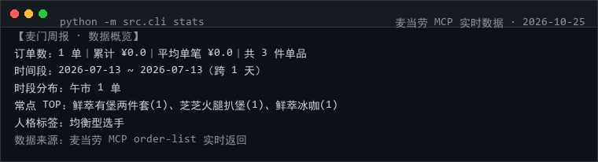
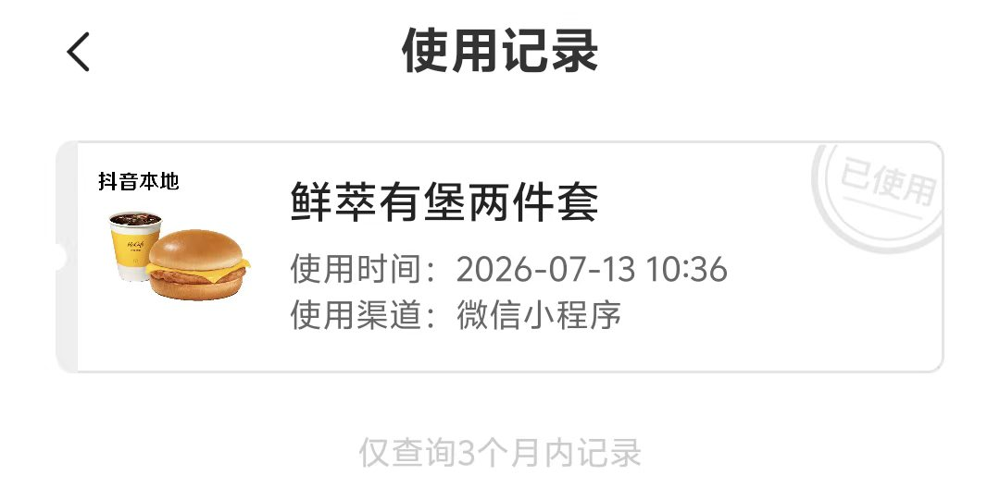

# 📊 mcd-moments · 麦门周报

> ⭐ **觉得有用就点个 Star** —— 本项目正在参加麦当劳程序员创意开发大赛，排名唯一依据就是 Star 数。**零依赖、可离线运行，无需 Token 也能验证。**


> 把你在麦当劳的订单数据，编译成一份**能晒出去的单文件 HTML 年报**。
> 零依赖、零 CDN、零 JS——一个 .html 文件，丢到 GitHub Pages 就是你的在线年报。

**和 Spotify Wrapped 一样的爽感，但数据是真的。**

```
$ python -m src.cli stats --offline

【麦门周报 · 数据概览】
订单数：16 单｜累计 ¥517.4｜平均单笔 ¥32.3｜共 32 件单品
时间段：2026-05-08 ~ 2026-10-17（跨 163 天）
时段分布：早餐 3 单、午市 5 单、下午茶 1 单、晚餐 4 单、夜宵 3 单
常点 TOP：芝芝火腿扒堡(3)、吉士双层汉堡(3)、鲜萃冰咖(2)、薯条(中)(2)、培根蔬萃双层牛堡(2)
人格标签：菜单探险家
```

> 实时版（配好 Token 后）用的是你自己的真实订单；上面这段跑的是 `samples/` 里的脱敏样例。

---

## 🔴 实时实测（2026-10-25，真实 MCP 调用）

```
$ python -m src.cli stats
【麦门周报 · 数据概览】
订单数：1 单｜累计 ¥0.0｜平均单笔 ¥0.0｜共 3 件单品
时间段：2026-07-13 ~ 2026-07-13（跨 1 天）
时段分布：午市 1 单
常点 TOP：鲜萃有堡两件套(1)、芝芝火腿扒堡(1)、鲜萃冰咖(1)
人格标签：均衡型选手
数据来源：麦当劳 MCP order-list 实时返回
```



**如实说明两件事**（这比把报告做得好看更重要）：

1. 该账号 `order-list` 目前只返回 **1 单**，所以实时报告的信息量确实有限 —— 项目不会用假数据填满图表；
2. 这单的 `realTotalAmount` 实付为 `0`（权益兑换场景），项目就如实记 ¥0.0，不会去找个"看起来合理"的价格替代。

**交叉验证（为什么敢说这是真数据）**：账号所有者在麦当劳小程序的使用记录里，能看到同一笔 **2026-07-13 10:36 鲜萃有堡两件套（微信小程序渠道）**，与 `order-list` 接口返回的 `2026-07-13 10:28:40` 那笔订单在餐品与日期上完全一致，见下图（项目所有者本人账户截图，已去除账号信息）：



订单太少时，`samples/` 里的 16 单脱敏样例反而是更好的演示素材 —— 两种模式随时可切，数据来源永远写在报告页脚里。

---

## 为什么做这个

1000 多个参赛作品里，「省钱 / 推荐 / 营养」占了绝大多数，**但几乎没有人在做「数据叙事」**。
而麦当劳 MCP 恰好提供了别人没有的东西：你的**真实历史订单**。

| 别人在做 | 本项目在做 |
|---|---|
| 帮我点这一顿 | 告诉我这半年我到底吃了些什么 |
| 省多少钱 | 我是什么类型的「麦门选手」 |
| 推荐搭配 | 生成一张能发出去的年报 |

整个分析不依赖大模型：所有统计都是确定性 Python 计算，同样的数据永远得到同样的报告。

---

## 报告长什么样

生成的页面包含：

- **四个核心数字**：下单次数、累计金额、平均单笔、覆盖天数
- **人格标签**：夜宵常客 / 早餐党 / 周末出动 / 专一星人 / 菜单探险家 / 大手笔 / 精算达人 / 真正麦门信徒 —— 每条标签都注明判定口径（鼠标悬停可见）
- **时段分布**：早餐 / 午市 / 下午茶 / 晚餐 / 夜宵 的条形图
- **星期分布**：纯 SVG 环形图
- **最常点 TOP5** + **常去门店**
- **三个片段**：最早的一单、最晚的一单、最大手笔

配色用红黄品牌色系做视觉呼应，响应式布局，手机也能看。

---

## 安装

```bash
git clone https://github.com/susevenci/mcd-moments.git
cd mcd-moments                # 零依赖，Python 3.8+，无需 pip install
python -m src.cli stats --offline
python -m src.cli build --offline --title "我的麦门周报" --out output/mcd-moments.html
```

真实数据：

```bash
cp .env.example .env          # 填入 MCD_MCP_TOKEN
python -m src.cli selfcheck
python -m src.cli build --title "2026 我的麦门年报"
```

## 命令

| 命令 | 作用 |
|---|---|
| `stats` | 终端看统计概览（`--json` 出结构化） |
| `build` | 生成 HTML 年报（`--out` 指定路径，`--title` 自定义标题） |
| `selfcheck` | Token 自检 |

## 直接开 GitHub Pages

仓库里 `docs/index.html` 就是现成的报告样例。Settings → Pages → Source 选 `main / docs`，
立刻就能拿到一个可分享链接——这也是本项目最容易传播的形态。

---

## 隐私底线

这一条写得比功能还硬：

1. 仓库里的 `samples/orders_sample.json` 是**脱敏样例**，订单号统一 `OMASK…` 前缀、门店名统一「示例-」，有单测强制校验，防止误提交真实数据；
2. 实时数据只走 `order-list` **只读**接口，不做任何写操作；
3. Token 仅通过环境变量读取，`.gitignore` 排除 `.env`；
4. 报告是本地文件，是否公开由你自己决定。

---

## MCP 使用速览

| Tool | 用途 |
|---|---|
| `order-list` | 历史订单（`orderId` / `createTime` / `storeName` / `orderProductList` / `realTotalAmount`） |
| `query-my-account` | 连通性自检 |
| `campaign-calendar` | 扩展点：把「那年一起追过的新品」并入年报 |

详见 [MCP_INTEGRATION.md](./MCP_INTEGRATION.md)。

## 真实性对照表

| 内容 | 状态 | 说明 |
|---|---|---|
| 全部统计口径 | ✅ 真实 | 确定性 Python 计算，17 项单测覆盖，输入相同输出必相同 |
| 人格标签 | ✅ 真实 | 每条都写明触发口径（如"夜宵时段占 32%"） |
| 实时模式的数字 | ✅ 真实 | 直接来自 `order-list` |
| `samples/orders_sample.json` | 🟡 脱敏样例 | 结构同真实返回，数值为示意，文件头已标注 |
| 金额说明 | ⚠️ 口径 | 取 `realTotalAmount`（实付），不等于原价合计 |

## 参赛合规自查

| 官方要求 | 本仓库 |
|---|---|
| README / CONTEST_DECLARATION / MCP_INTEGRATION / workbuddy / 示例配置 | ✅ |
| 无真实 Token | ✅ 仅环境变量 |
| 不含他人个人信息 | ✅ 样例已脱敏，并有单测防止回归 |
| 内容合规 | ✅ 无贬损品牌表述 |

## 测试

```bash
python -m unittest discover -s tests -p "test_*.py"   # 17 项，无需 Token
```

包含：HTML 不得内联 script、不得引外部资源、用户输入必须转义、样例数据中不得出现真实标识。

## 免责

参赛作品，非麦当劳官方产品。金额与订单信息以麦当劳官方渠道为准。

MIT © 2026

---
## 作者的另外三个参赛作品
- [麦麦安心点](https://github.com/susevenci/mcd-safe-order) —— 特殊人群的麦当劳安全点餐三档筛查（儿童/老人/孕产/减脂/控钠控糖/素食）
- [麦门抽奖情报局](https://github.com/susevenci/mcd-prize-radar) —— 积分抽奖体检：能不能抽、还差多少分、奖池有什么、攒分路径在哪
- [麦当劳到店真相](https://github.com/susevenci/mcd-store-truth) —— 券 × 门店 TRUE/FALSE/UNKNOWN 三态确定性校验器

> 四个项目均已报名（报名 Issue #1342–#1345），同样参加「麦当劳程序员创意开发大赛 · 1024 程序员节」。如果这个项目帮到了你，欢迎去给另外几个也点上 Star。
